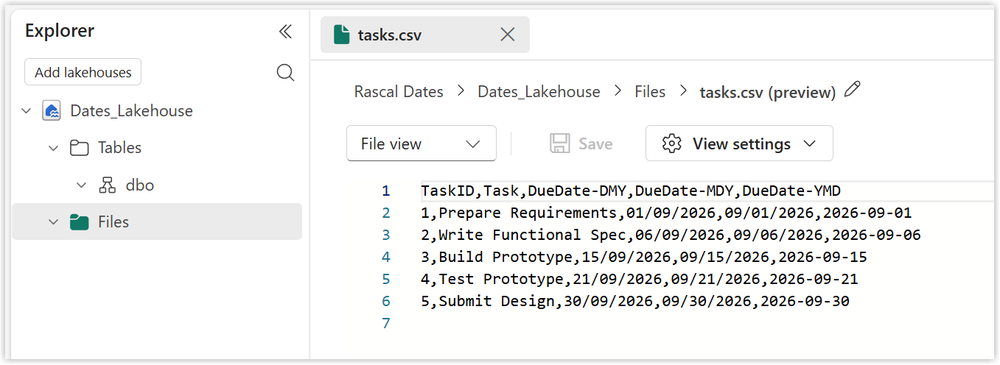
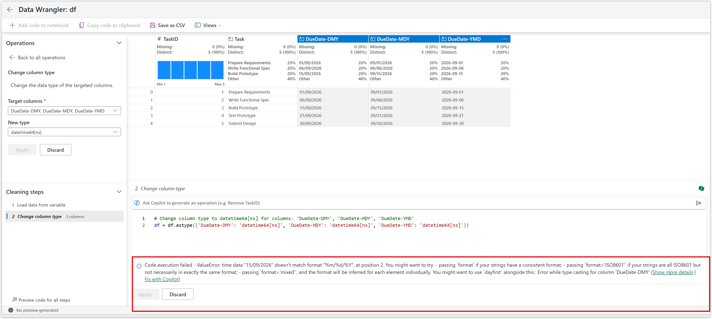
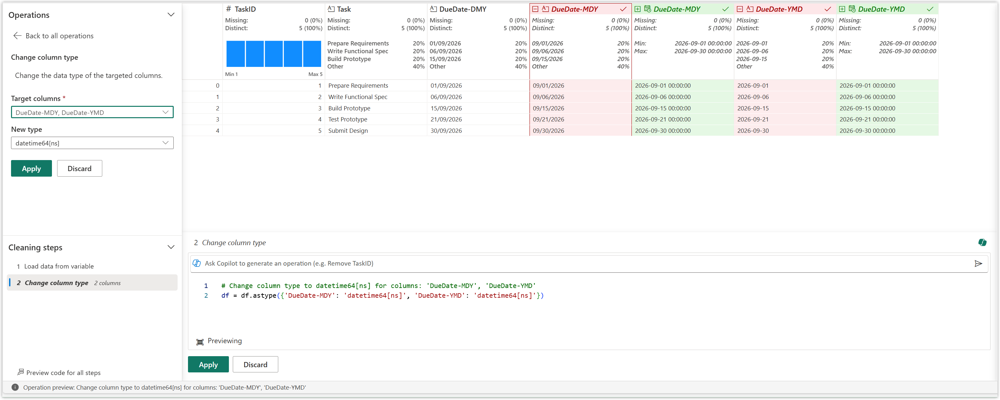
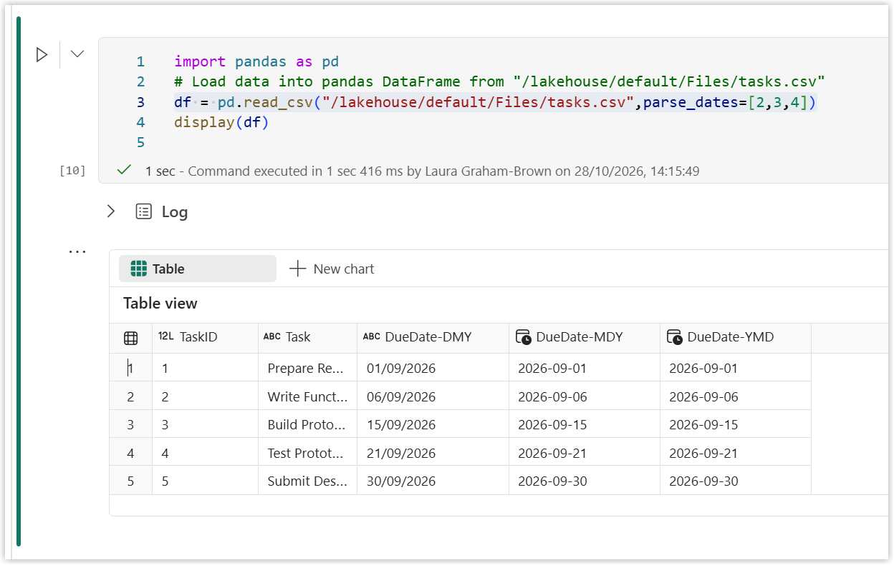
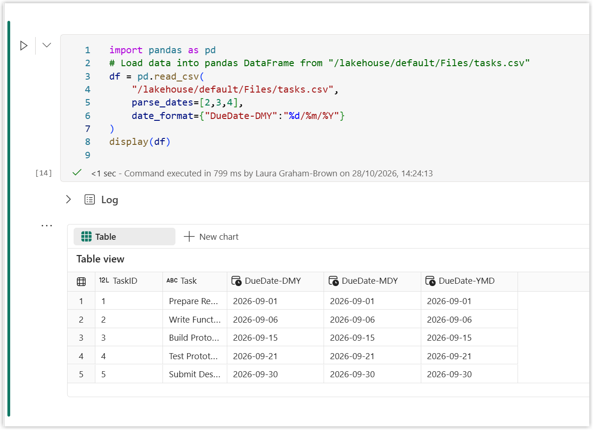

Data Wrangler is one of my favourite tools within Microsoft Fabric. It has taught me lots of different ways to do simple transformations to a dataframe within a notebook. So with a client I plowed in to show them a demo, and in true me fashion it broke. I spent a little time solving the problem and whenever you solve a technical issue you should write a blog post, so you remember it next time!

## Scenario

I have a csv file listing 5 tasks with due dates. I've repeated the due dates in three formats, DMY, MDY and YMD. The common formats we come across. And I've loaded that file into a lakehouse so I can easily load it into a notebook.



I'm going to walk through loading and transforming the file using Pandas and using Spark data frames in Data Wrangler.

## Pandas Version


So from the file in the lakehouse, I click the three dots and select Load data and Pandas. Its writes a few lines of code which when run shows a table and all three date columns are text.

I click the Data Wrangler button just above the table shown. I select the three date columns and select to change data type. I pick datetime64[ns] as the type. But it shows an error. It doesn't like the DMY format.



The error show is the following

> Code execution failed - ValueError: time data "15/09/2026" doesn't match format "%m/%d/%Y", at position 2. You might want to try: - passing `format` if your strings have a consistent format; - passing `format='ISO8601'` if your strings are all ISO8601 but not necessarily in exactly the same format; - passing `format='mixed'`, and the format will be inferred for each element individually. You might want to use `dayfirst` alongside this.: Error while type casting for column 'DueDate-DMY'

But where to put that "format='xxx'"? There isn't anywhere in the code shown. So I unselect the DMY column from the Target columns in the left pane and its then happy. It shows the red before columns and the green after columns and I can now click Apply.



When I click Add code to notebook it adds a new code block with the standard clean_data function. But that doesn't fix the DMY column. It is still a date.

So I add a row into that function that will do the date conversion. I add this code just before the return df line. And then run the code block.

```python
df['DueDate-DMY'] = pd.to_datetime(df['DueDate-DMY'], format='%d/%m/%Y')
```


## Spark Version

Lots of us use Spark, rightly or wrongly but mostly because its easy. I'll leave the conversation on capacity usage to another blog series and probably another author. 

In a new notebook I use almost the same technique as above and load the csv file into a Spark dataframe.


I then click Data Wrangler to do the column changes. Data Wrangler writes in panda and then converts to spark. So we know it can't do DMY so I just convert the MDY and YMD columns. This is exactly the same as before I then click Copy Code to Notebook.


Interestingly the 7th line of the code is a comment that reads

> \# ⚠️ Timestamp format may not be supported. Please check the results and modify if needed.

And it is correct to warn us as the MDY column only returns nulls. It cannot handle the MDY format. The fix is to load ```functions``` from the ```pyspark.sql``` library and use ```to_timestamp``` or there is a ```to_date``` option. This can be seen in lines 4, 9 and 10 in the code below. It works great.

```python {linenos=inline hl_lines=["4", "9-10"] style=emacs}
# Code generated by Data Wrangler for PySpark DataFrame

from pyspark.sql import types as T
from pyspark.sql import functions as F

def clean_data(df):
    # Change column type to datetime64[ns] for columns: 'DueDate-MDY', 'DueDate-YMD'
    # ⚠️ Timestamp format may not be supported. Please check the results and modify if needed.
    df = df.withColumn('DueDate-DMY', F.to_timestamp('DueDate-DMY','dd/MM/yyyy'))
    df = df.withColumn('DueDate-MDY', F.to_timestamp('DueDate-MDY','MM/dd/yyyy'))
    df = df.withColumn('DueDate-YMD', df['DueDate-YMD'].cast(T.TimestampType()))
    return df

df_clean = clean_data(df)
display(df_clean)
```

## Alternative Pandas Method

Did you notice Pandas made the TaskID column a long on the read_csv step? This means it can do some sort of data conversion. Can it do dates? So I went to look at the documentation.

[pandas.read_csv documentation](https://pandas.pydata.org/docs/reference/api/pandas.read_csv.html)

read_csv has lots of parameters, lots worthy of blog posts. But I'm interested in ```parse_dates``` and ```date_format```. 

If we start with parse dates and supply it a list of the column numbers, remembering first column is index 0. So we add ```parse_dates=[2,3,4]``` as an extra parameter to the read_csv code block it almost works. It parses the MDY and YMD columns but leaves the DMY column as text.



Then using ```date_format``` we pass in the format for the DMY column by adding ```date_format={"DueDate-DMY":"%d/%m/%Y"}``` as another parameter to read_csv. When run all three columns are datetime columns and very little code changed



The final code for this alternative is

```python
import pandas as pd
# Load data into pandas DataFrame from "/lakehouse/default/Files/tasks.csv"
df = pd.read_csv(
    "/lakehouse/default/Files/tasks.csv",
    parse_dates=[2,3,4], 
    date_format={"DueDate-DMY":"%d/%m/%Y"}
)
display(df)
```

This is just touching the surface of what you can do with read_csv.

## Conclusion

I hate date formats, American or UK; we both do it in a weird order. The ISO8601 standard of the format YYYY-MM-DD hh:mm:ss starts with the biggest unit and works down to the smallest and makes the most sense. So if we had control of the date format I would insist on ISO8601 but we rarely get that control.

Hopefully the ideas here give us some new ideas on handling files and importing. It shows how sometimes a little bit of reading can create a simpler solution.


