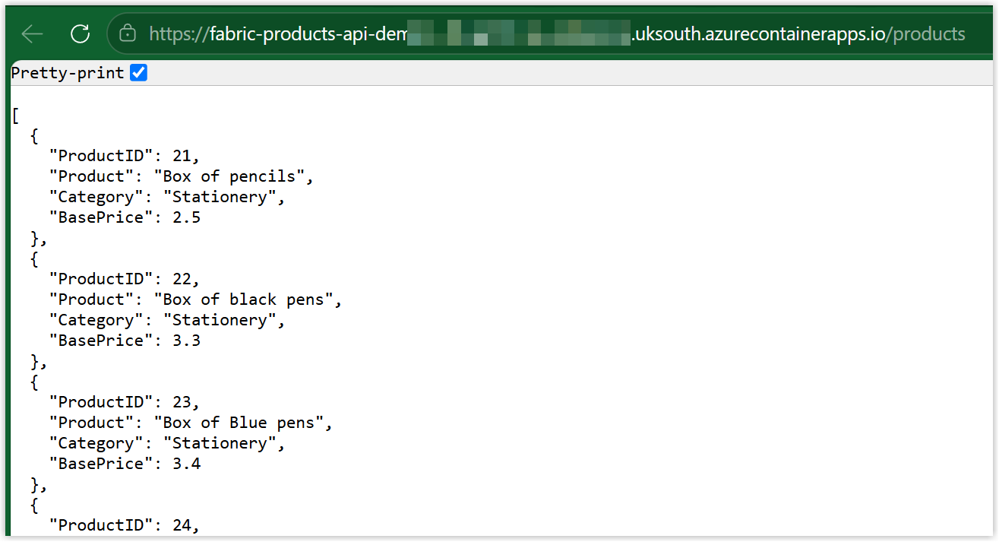
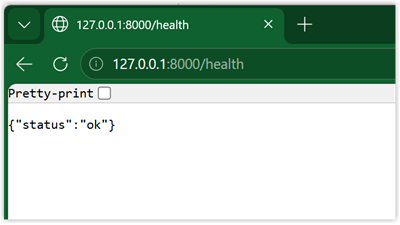
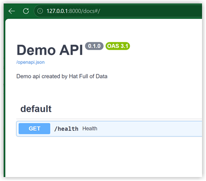
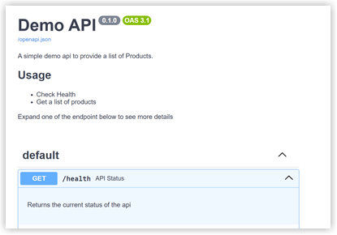
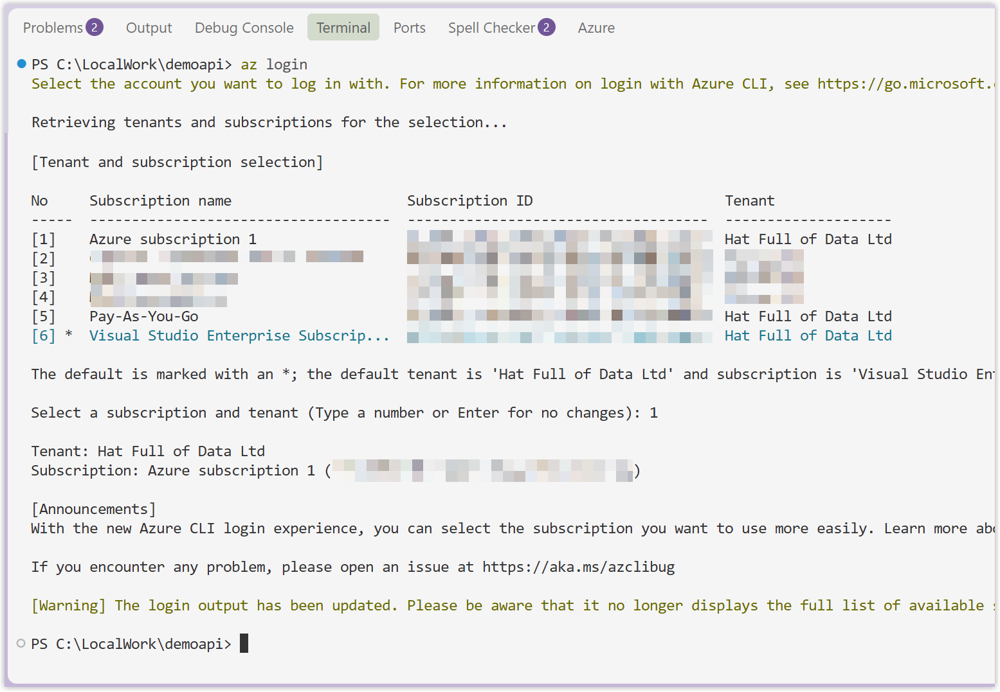
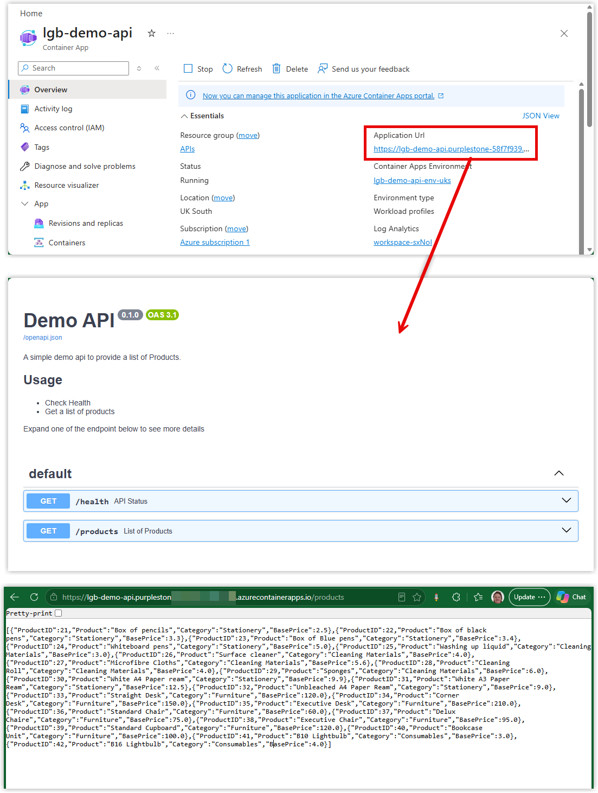

Azure is not my comfort zone, but I got fed up of asking users to load csv files into a lakehouse in my Fabric Introduction workshop. That will not match the reality back in the office. Although there might be the odd csv file being loaded, it is more likely to be API calls. I wanted to keep the API calls simple and guaranteed results. This means I needed to create own from my own sample data. So that future-me has a chance of understanding this here is my blog post.

This does require a subscription in Azure and the permission to create a variety of objects. **The API created has zero security as in anyone can open it. So this is for demo data only!**

## Final Goal

This API is going to be deliberately simple, a url that returns a json file so a copy job could save the result as a json file. This could be the first step in a data pipeline. The source I'm going to use is a csv file I already have which is a list of products. I'm going to do this all in VS Code and code in Python.



## Create a local folder

We are going to develop and test locally and then publish it to Azure. So create a folder on the C drive to store the API config in. I picked ```C:\LocalWork\demoapi``` and then open that folder in VS Code

## Check installations

We need to have software installed locally for this to work. So the easiest way to check this is to check the versions. 

> [!NOTE]Instructions
> 1. In the terminal window type in ```python --version```
> 1. If you get an error, go to [https://www.python.org/downloads/](https://www.python.org/downloads/) and install python
> 1. In the terminal window type in ```az --version```
> 1. if you get an error, go to [https://learn.microsoft.com/en-us/cli/Azure/install-Azure-cli?view=Azure-cli-latest](https://learn.microsoft.com/en-us/cli/Azure/install-Azure-cli?view=Azure-cli-latest) and install Azure CLI 


## Simplest API

The simplest return from an API is checking on the health and we just expect a ```{"status":"ok"}``` back. So that is what we will start with. Our code requires a couple of packages that aren't included with Python so we need to specify them in a requirements.txt file.

> [!NOTE]Instructions
> 1. Create a file called requirements.txt
> 1. Copy the code below into the file and save
> 1. In the terminal window type in ```python -m pip install -r requirements.txt```

```
fastapi
uvicorn
```

Next is to write the simplest API code to provide the /health check.

> [!NOTE]Instructions
> 1. Create a file called main.py
> 1. Copy in the code below into the file and save
> 1. In the terminal window type in ```python -m uvicorn main:app --reload --port 8000``` to start the local hosted api
> 1. Check you get a return that includes ```INFO:     Uvicorn running on http://127.0.0.1:8000 (Press CTRL+C to quit)```
> 1. In a browser go to [http://127.0.0.1:8000/health](http://127.0.0.1:8000/health)
> 1. You should get {"status": "ok"} back.

```python
from fastapi import FastAPI, HTTPException
from fastapi.responses import RedirectResponse

app = FastAPI(
    title="Demo API",
    description="Demo API created by Hat Full of Data"
    )

@app.get("/health")
def health():
    return {"status": "ok"}
```



## Explaining /docs

Creating an API this method has the added bonus of a /docs page automatically created. With the local hosted API running navigate to [http://127.0.0.1:8000/docs](http://127.0.0.1:8000/docs) and you will get a very simple guide to the api.



You can add more descriptions etc to the main.py to make this page more informative using markdown strings. Another addition is if no relative path is provided to redirect the /docs. This requires loading an extra library called RedirectResponse. The code would now be

```python
from fastapi import FastAPI, HTTPException
from fastapi.responses import RedirectResponse

apidescription = """
A simple demo API to provide a list of Products.

## Usage

* Check Health
* Get a list of products

Expand one of the endpoint below to see more details
"""

app = FastAPI(
    title="Demo API",
    description=apidescription
    )

@app.get(
    "/health",
    summary="API Status",
    description="Returns the current status of the api"
)
def health():
    return {"status": "ok"}

@app.get("/", include_in_schema=False)
def root():
    return RedirectResponse(url="/docs")
```



## Adding Products Data

The above has proven the concept of an api, now we need to add some data and this is going to come from Products.csv. For each line of the csv file we are going to append a json item called products and that is what the API will return. 

Here is the final code. The changes are the new imports on lines 3-4 and the new function added in from lines 34 onwards.


```python {linenos=inline hl_lines=["3-4", "34-50"] style=emacs}
from fastapi import FastAPI, HTTPException
from fastapi.responses import RedirectResponse
import csv
from pathlib import Path

apidescription = """
A simple demo API to provide a list of Products.

## Usage

* Check Health
* Get a list of products

Expand one of the endpoint below to see more details
"""

app = FastAPI(
    title="Demo API",
    description=apidescription
    )

@app.get(
    "/health",
    summary="API Status",
    description="Returns the current status of the api"
)
def health():
    return {"status": "ok"}

@app.get("/", include_in_schema=False)
def root():
    return RedirectResponse(url="/docs")

@app.get(
    "/products",
    summary="List of Products"
)
def products():
    csv_file = Path("Products.csv")
    products = []
    with csv_file.open(mode="r", encoding="utf-8-sig", newline="") as f:
        reader = csv.DictReader(f)
        for row in reader:
            products.append({
                "ProductID": int(row["ProductID"]),
                "Product": row["Product"],
                "Category": row["Category"],
                "BasePrice": float(row["BasePrice"])
            })
    return products
```

Once you have that working press Ctrl+C to stop the local hosted api.

## Publishing to Azure

So now we have an API we just need to publish it to Azure so it can be accessed from anywhere, ie where I run my workshop. I will be honest here, this is where AI, some reading and crossing my fingers and hoping this works happened.

### Login

The first step is to login to Azure, so in the terminal window type ```az login``` and walkthrough the steps to select the right tenancy and subscription.



### Check Resource Providers

Azure subscriptions need the appropriate resource providers enabled before resources can be created. If you're using an existing subscription, these may already be registered. Check the status of them by typing the following code into the terminal.

```powershell
az provider show --namespace Microsoft.App --query registrationState -o tsv
az provider show --namespace Microsoft.ContainerRegistry --query registrationState -o tsv
az provider show --namespace Microsoft.OperationalInsights --query registrationState -o tsv
```
If you get registered returned for all of them they are registered, if they aren't registered use this code to register them.

```powershell
az provider register --namespace Microsoft.App
az provider register --namespace Microsoft.ContainerRegistry
az provider register --namespace Microsoft.OperationalInsights
```

### Dockerfile

The Dockerfile contains the instructions in how to package our API files into a container in Azure. As our API develops we will need to update the file.

> [!NOTE]Instructions
> 1. Create a file called Dockerfile - with no extension
> 1. Copy in the code below

```
FROM python:3.11-slim
WORKDIR /app

COPY requirements.txt .
RUN pip install --no-cache-dir -r requirements.txt

COPY main.py .
COPY Products.csv .

EXPOSE 80
CMD ["python", "-m", "uvicorn", "main:app", "--host", "0.0.0.0", "--port", "80"]
```

### Deploy

Now we have everything set we can deploy. I already have a resource group in Azure called "APIs" in uksouth and we need to make names for an environment and containerapp. Don't shoot me for naming conventions.

To make the deployment commands easier to update to your values and for my future projects we are going to create variables to store the name of a few parts. $RG is the resource group and $LOC is the Azure region. Then $ENV and $APP are the names of the new environment and app you are creating. Obviously replace the names with your own

```powershell
$RG="APIs"
$LOC="uksouth"
$ENV="lgb-demo-api-env-uks"
$APP="lgb-demo-api"
```

Next we create the container, so type into the terminal this

```powershell
az containerapp env create -n $ENV -g $RG -l $LOC
```

This takes a while and will end with a big long json. Next we do the actual deployment of the app part. Type into the terminal this code and wait for it to finish.

```
az containerapp up -n $APP -g $RG -l $LOC --environment $ENV --source . --target-port 80 --ingress external
```

## Check in Azure

Now we have deployed we can head to Azure to check. 

> [!NOTE]Instructions
> 1. Navigate to [https://portal.Azure.com/](https://portal.Azure.com/)
> 1. In the recent resources find the Container App and open it
> 1. Click on the Application Url to see if it works
> 1. Try adding on /products to check that it works



## Conclusion

So this was for me to work out how to have data for a Fabric workshop that doesn't start with download csv files. Its not my comfort zone and this API has no security and obviously would not be good for real data. I will leave that to the Azure specialists, this is for demo only.